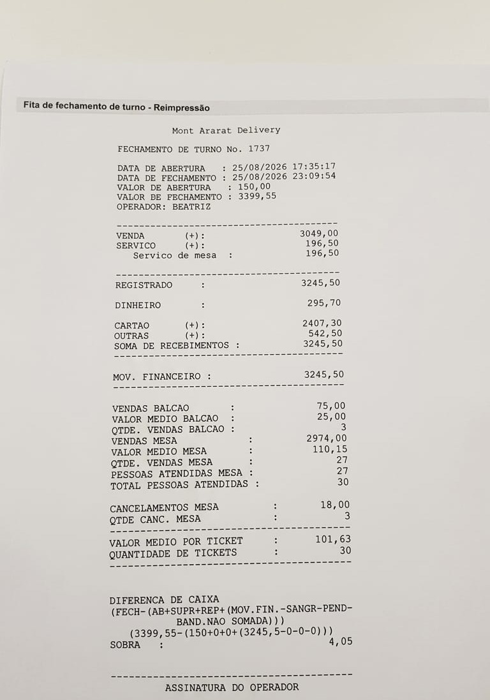
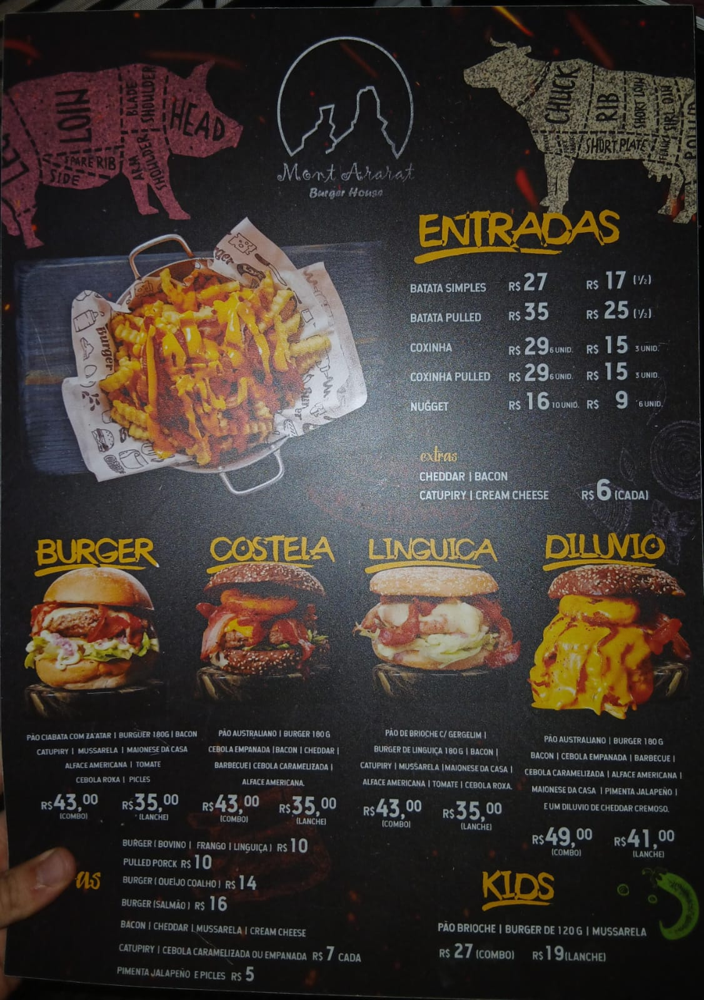
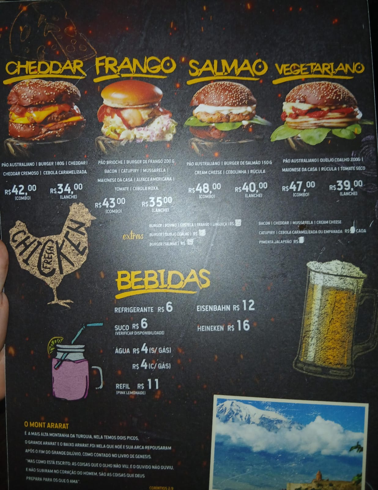
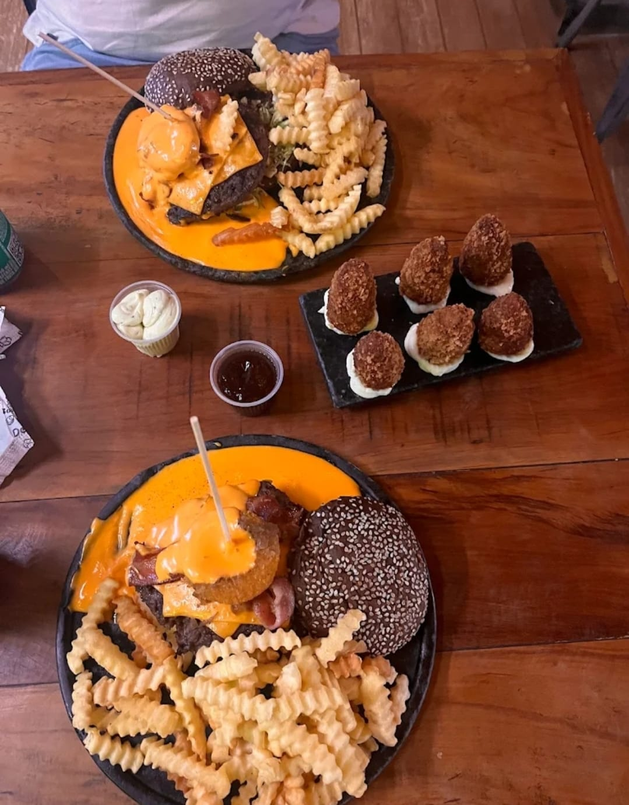
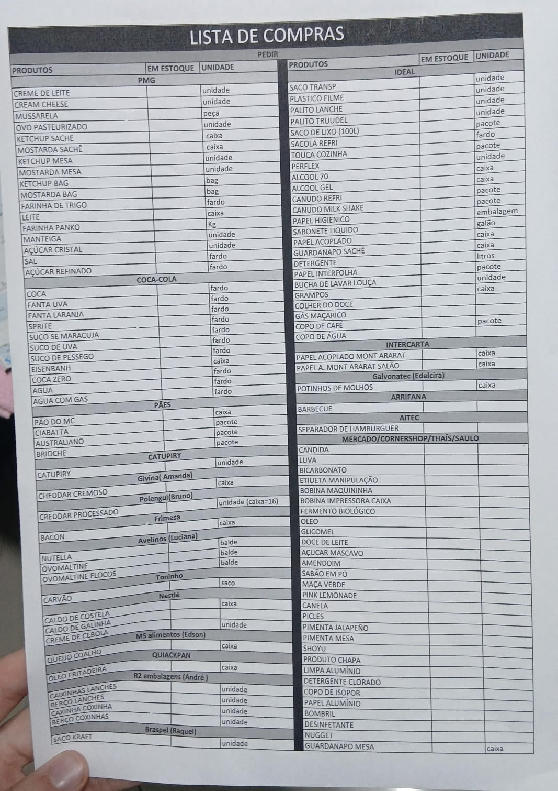

# MONTARARAT – BANCO DE DADOS
### Entrega final: modelagem conceitual, modelo lógico e banco de dados MySQL
---
**Integrantes do Grupo (Nomes e RGMs):**
* **Anna Luiza Ferreira Costa** | RGM: 48186198
* **Bruno da Silva Nascimento** | RGM: 48078883
* **Diogo de Castro Moreira** | RGM: 47629045
* **Guilherme Souza do Carmo** | RGM: 47856424
* **Henrique Santos Brunheiro** | RGM: 48071439
* **Kauan Ferreira da Silva Luiz** | RGM: 47728035
* **Maria Eduarda Lima Pereira** | RGM: 48049018
* **Matheus Victoriano Pires Barbosa** | RGM: 47387980
* **Nicole Alejandra Apaza Mamani** | RGM: 47259701
* **Vinícius Nogueira Martins** | RGM: 47697318
* **Yasmin Gonçalves Pucci Salem** | RGM: 48259357
---
## 1. SOBRE A EMPRESA
A empresa selecionada pelo grupo foi o **Montararat**, uma hamburgueria localizada na zona leste de São Paulo, no bairro de São Mateus. Focada no comércio de lanches e porções, a hamburgueria tem como seus principais clientes os moradores da região, que frequentam o estabelecimento físico ou pedem via delivery. Seus principais setores são:
* **Atendimento ao cliente:** Formado pelo(a) atendente do balcão e garçons, atuam na recepção de clientes, consulta ao cardápio, recepção e lançamento de pedidos (presenciais e retirada), atendimento das mesas e entrega de pedidos.
* **Operações / Produção (Cozinha):** A equipe da cozinha (chapeiros, cozinheiros, auxiliares) age na produção dos hambúrgueres e acompanhamentos, controle de fila e tempo dos pedidos na chapa, montagem dos pratos e solicitação de reposição de insumos.
* **Financeiro:** O(a) atendente do balcão e o(a) gerente são responsáveis pelo fechamento do caixa, recebimento de pagamentos (PIX, Cartão, Dinheiro) e pela emissão de comprovantes.
* **Gestão e Administração:** O(a) gerente lidera esse setor na supervisão geral do funcionamento do salão e da cozinha, gerenciamento de estoque, escala da equipe, relatório de vendas, controle financeiro geral e autorizações especiais (como cancelamento de pedido ou descontos).
* **Estoque e Compras:** Nesse setor, o(a) gerente e a equipe da cozinha realizam a conferência de insumos (pães, carnes, queijos, bebidas), registro de entrada/saída de produtos, identificação de itens em falta e pedido de compra com o fornecedor.
**Horários de funcionamento:**
* Terça à Quinta (18h – 23h)
* Sexta e Sábado (18h – 00h)
* Domingo (18h – 23h)
---
## 2. CONTEXTUALIZAÇÃO E MOTIVAÇÃO
A escolha da hamburgueria Mont Ararat como objeto desse estudo se dá por ser uma empresa próxima da região, somada a um alto volume de vendas e um gerenciamento pouco organizado, gerando um conjunto de motivos favoráveis para a agregação de um ERP ao sistema da empresa.

*(Evidência 1) - Relatório impresso de fechamento de caixa, em um dia moderadamente movimentado, operado no terminal de delivery.*
---
## 3. PROCESSOS DE NEGÓCIO
Em geral, o processo operacional padrão que engloba o funcionamento da empresa segue dois fluxos principais, que variam de acordo com o local de consumo (presencial ou delivery):
### 3.1 PRESENCIAL
`Cliente` ➔ `Atendimento e Pedido` ➔ `Produção` ➔ `Entrega e Consumo` ➔ `Pagamento`
### 3.2 DELIVERY
`Cliente` ➔ `Atendimento e Pedido` ➔ `Pagamento` ➔ `Produção` ➔ `Entrega e Consumo`
### 3.3 DETALHAMENTO DAS ETAPAS
* **Cliente:** Entrada do cliente no estabelecimento ou acesso às plataformas digitais de atendimento/delivery (iFood / 99food).
* **Atendimento e Pedido:** Recepção da solicitação do cliente, escolha dos itens do menu, registro das preferências/observações e envio do pedido para o sistema.
* **Pagamento:** Realização e validação da transação financeira (PIX, Cartão ou Dinheiro). No fluxo DELIVERY, essa etapa antecede a produção; no fluxo PRESENCIAL, ela ocorre após o consumo.
* **Produção:** Recebimento da comanda pela cozinha, preparo dos hambúrgueres e acompanhamentos na chapa, montagem e embalagem.
* **Entrega e Consumo:** No fluxo DELIVERY, o pedido já embalado é repassado ao entregador (motoboy) para realização da entrega no endereço solicitado pelo cliente. No fluxo PRESENCIAL, o pedido é entregue na mesa do cliente, servido para ser consumido no local.


*(Evidência 2) - Foto do cardápio da hamburgueria, com imagens dos hambúrgueres, bebidas, descrições e preços.*

*(Evidência 3) – Dois Dilúvios, lanche especial da casa, servidos em uma mesa, acompanhados de uma porção de coxinhas crocantes.*
---
## 4. PROBLEMAS E NECESSIDADES
A partir do estudo de caso do Mont Ararat, identificou-se que a principal fragilidade operacional se encontra na gestão e controle de estoque/suprimentos, que atualmente carece de organização e estruturação em Banco de Dados.

*(Evidência 4) – Lista de compras, contendo o estoque, onde os produtos são separados por categorias, marcas e necessidades.*

| Problema Identificado | Consequência para o Negócio |
| :--- | :--- |
| **Itens sem organização em ordem alfabética** | Lentidão e dificuldade na localização rápida de insumos. |
| **Fragmentação de itens de mesma categoria** | Desorganização no inventário e duplicidade acidental no cadastro de compras. |
| **Nomenclaturas de categorias confusas ou genéricas** | Dificuldade na filtragem de produtos e falhas na busca do sistema. |
| **Controle de estoque manual/informal** | Divergência de saldos, perdas e erros no levantamento de quantidades. |

---
## 5. REQUISITOS, REGRAS DE NEGÓCIO E POLÍTICAS (revisados)

Catálogo completo, com origem de cada mudança e forma de verificação: [`docs/requisitos/requisitos.md`](docs/requisitos/requisitos.md) (e `.xlsx`).
Resumo: **19 RF** (RF01-RF11 mantidos; RF12-RF17 novos para compras, financeiro, caixa, promoções, ocorrências e fila; RF18/RF19 vêm do antigo RNF02/RNF05, reclassificados), **6 RNF** (RNF01, RNF03, RNF04, RNF06 mantidos; RNF07 e RNF08 novos) e **15 RDN** (RDN01-RDN08 mantidos e tornados verificáveis; RDN09-RDN15 novos). A política organizacional da seção 8 original (cozinha, compras, aniversário, cancelamento, venda, prioridade) está formalizada nas regras RDN05, RDN09-RDN13.
Rastreabilidade requisito → tabela/view/trigger/consulta/teste: [`docs/requisitos/rastreabilidade.md`](docs/requisitos/rastreabilidade.md).

## 6. FLUXOGRAMAS (corrigidos)

| Processo | Diagrama |
|---|---|
| Pedido, pagamento, produção, entrega, encerramento, trocas | [`fluxograma-pedido.png`](docs/diagramas/fluxograma-pedido.png) |
| Compras, recebimento, conferência, reposição, perdas, inventário | [`fluxograma-compras-estoque.png`](docs/diagramas/fluxograma-compras-estoque.png) |
| Caixa e conferência financeira | [`fluxograma-caixa.png`](docs/diagramas/fluxograma-caixa.png) |

Fontes em Mermaid (`.mmd`) na mesma pasta. O fluxograma original em Lucidchart (`imagens/fluxograma.png`) permanece como histórico.

## 7. MODELAGEM

- **DER conceitual** (entidades, verbos, cardinalidades): [`docs/diagramas/der-conceitual.png`](docs/diagramas/der-conceitual.png)
- **Modelo lógico** relacional, 34 tabelas e 51 chaves estrangeiras: [`docs/modelo-logico.md`](docs/modelo-logico.md) e DER lógico [`der-logico.png`](docs/diagramas/der-logico.png) (ambos gerados do DDL)
- **Normalização** (14 problemas da 1ª entrega, verificação de dependências, desnormalizações intencionais): [`docs/normalizacao/normalizacao.md`](docs/normalizacao/normalizacao.md)
- **Dicionário de dados** (gerado do DDL; cada restrição com sua justificativa): [`docs/dicionario-dados/dicionario-de-dados.md`](docs/dicionario-dados/dicionario-de-dados.md)

## 8. BANCO DE DADOS (MySQL 8.0.16+ / MariaDB 10.5+)

```
sql/
  ddl/        01_create_database, 02_create_tables (34), 03_views (10), 04_triggers (8)
  dados/      01_massa_dados.sql  (gerada por ferramentas/gerar_massa.py; DADOS FICTÍCIOS)
  dml/        01_dml_demonstracao.sql  (INSERT/UPDATE/DELETE de um pedido, termina em ROLLBACK)
  consultas/  operacionais.sql (O01-O07), gerenciais.sql (G01-G13)
  auditoria/  auditoria.sql (AUD01-AUD10)
  testes/     02_testes_restricoes.sql (T01-T39, com controles positivos)
  ferramentas/ gerar_massa.py, gerar_docs.py, testar_tudo.py, catalogo.py, harness_sqlite.py
  executar_tudo.sql
```

**Como executar (MySQL):** na pasta `sql/`, `mysql -u root -p --force < executar_tudo.sql > ../evidencias/saida_mysql.txt 2>&1`. (Os testes de restrição geram erros esperados; `--force` continua.) No Workbench, rode os arquivos na ordem de `executar_tudo.sql`.

**Como regenerar documentos e verificar** (Python 3, só biblioteca padrão e openpyxl): `python3 sql/ferramentas/gerar_massa.py`, `gerar_docs.py` e `testar_tudo.py`. O resultado da última verificação está em [`evidencias/log_verificacao.txt`](evidencias/log_verificacao.txt).

Destaques técnicos: estoque como livro de movimentações (saldo por view); baixa automática pela ficha técnica; totais derivados em views; regras de negócio em CHECK e triggers; massa com 221 pedidos em 3 semanas, reajuste de preço, cancelamentos, estornos, pagamentos divididos, lotes e perdas; **seis anomalias plantadas** que as consultas de auditoria encontram (A-F, descritas no cabeçalho da massa).

## 9. HISTÓRICO DE ALTERAÇÕES E DECISÕES

- [`docs/historico-alteracoes.md`](docs/historico-alteracoes.md): cada item da devolutiva (nota 5,25) → correção → evidência.
- [`docs/decisoes-a-confirmar.md`](docs/decisoes-a-confirmar.md): 15 interpretações assumidas e dados fictícios.
- [`docs/limitacoes.md`](docs/limitacoes.md): o que não foi feito ou testado.

## 10. BI E IA

[`docs/bi-ia.md`](docs/bi-ia.md) (indicadores já respondidos por SQL; ideias de IA marcadas como proposta) e [`docs/ia/uso-de-ia.md`](docs/ia/uso-de-ia.md) (registro de uso e validação).

## 11. EQUIPE E PARTICIPAÇÃO

[`docs/divisao-trabalho.md`](docs/divisao-trabalho.md) (preencher) e roteiro de defesa em [`apresentacao/roteiro-defesa.md`](apresentacao/roteiro-defesa.md).

## 12. CONSIDERAÇÕES FINAIS

A revisão seguiu a sequência recomendada: Problema → Processo → Requisito → Regra de Negócio → Entidade → Relacionamento → Cardinalidade → DER → Dicionário de Dados, e só então o modelo lógico e o SQL. A principal correção foi deslocar o foco do atendimento para o problema real da empresa, o controle de estoque e de compras, sem perder a integração financeira.
